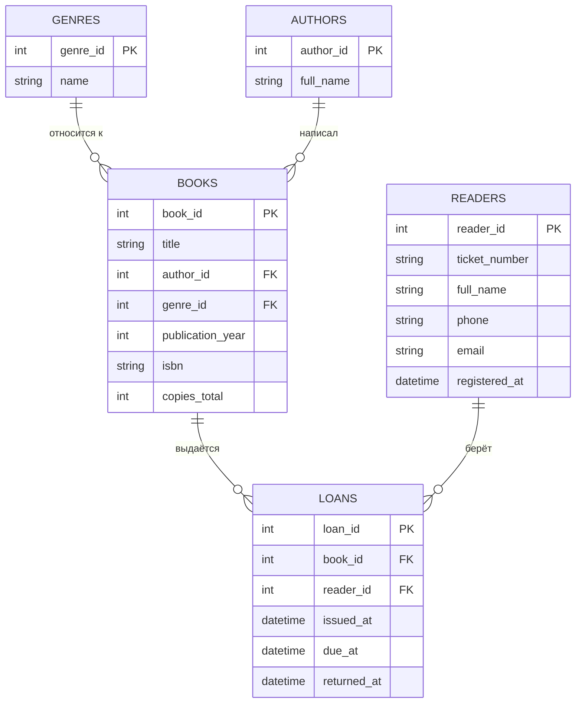

# Библиотека: предметная область, требования, бизнес-процессы

Черновик для отчёта по практике. Подправьте под своё обследование и требования руководителя.

## 1. Предметная область

Небольшая библиотека выдаёт книги читателям на ограниченный срок. Библиотекарь ведёт каталог книг, регистрирует читателей, оформляет выдачу и возврат и следит за просрочками. Посетитель сайта может искать книги и видеть, есть ли свободные экземпляры.

Основные понятия: **книга** (название, автор, жанр, год, число экземпляров), **читатель** (ФИО, номер билета, контакты), **выдача** (книга, читатель, дата выдачи, срок возврата, дата возврата).

## 2. Роли

- **Посетитель** — ищет книги и смотрит карточки.
- **Библиотекарь** — управляет каталогом, читателями и выдачей (вход по паролю).

## 3. Требования к информационной системе

Функциональные:

1. Просмотр каталога, поиск по названию и автору, фильтр по жанру.
2. Карточка книги с числом свободных экземпляров.
3. Добавление и удаление книг (библиотекарь).
4. Регистрация читателя с автоматическим номером билета.
5. Выдача книги читателю на 14 дней с проверкой правил.
6. Приём возврата; отметка просроченных выдач.
7. История выдач читателя; список книг на руках.
8. Разграничение доступа: служебные страницы только после входа.

Нефункциональные: работа в браузере, данные сохраняются между запусками, экранирование пользовательского ввода, запуск в Docker.

Бизнес-правила: срок выдачи 14 дней; не более 5 книг у читателя; при просрочке новые книги не выдаются; свободных экземпляров должно хватать; одну книгу нельзя выдать читателю повторно, пока он её не вернул; книгу с историей выдач удалять нельзя.

## 4. Бизнес-процессы

**БП-1. Поиск книги (посетитель).** Посетитель открывает каталог → вводит название или автора и/или выбирает жанр → система показывает подходящие книги с числом свободных экземпляров → посетитель открывает карточку.

**БП-2. Регистрация читателя (библиотекарь).** Вход → «Читатели» → «Новый читатель» → ввод ФИО и контактов → система проверяет данные, присваивает номер билета и сохраняет читателя.

**БП-3. Выдача книги (библиотекарь).** «Выдача» → «Выдать книгу» → выбор книги и читателя → система проверяет правила (просрочки, лимит 5, свободные экземпляры, повтор) → при успехе создаёт выдачу со сроком +14 дней, при отказе сообщает причину.

**БП-4. Возврат книги (библиотекарь).** «Выдача» → список книг на руках → «Принять возврат» → система ставит дату возврата, экземпляр снова доступен.

**БП-5. Пополнение каталога (библиотекарь).** «Каталог» → «Добавить книгу» → ввод данных → система проверяет их, создаёт автора при необходимости, сохраняет книгу.

## 5. Модель данных

Полные DDL-определения с ограничениями — в `schema.sql`. Для Toad Data Modeler: импортируйте скрипт через обратное проектирование и постройте диаграмму.

## 6. Что в реализации сейчас

Сайт на Go хранит данные в JSON-файле (`data/library.json`) с теми же сущностями и правилами, что в `schema.sql`. Переход на PostgreSQL потребует только заменить методы `Store` в `store.go` на SQL-запросы с драйвером (например, `pgx`); страницы и шаблоны менять не нужно.
